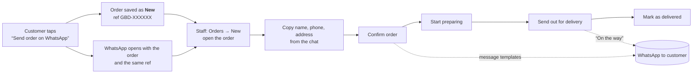

# Admin dashboard

The dashboard lives at **`/admin`** on the same website. It is where the team manages WhatsApp orders, products, customers, reminder sign-ups, shop settings and who can sign in. It works on phones first (bottom tabs) and on desktop (sidebar).

- Frontend: `src/admin/` (its own lazily-loaded bundle — shoppers never download it)
- API: `server/routes-admin.mjs` (`/api/admin/*`), database `data/giftsbydeesh.db` (SQLite)

---

## 1. Getting started

1. Start the site: `npm run dev` and `npm run api` (two terminals), or `npm run build && npm start` in production.
2. Open **`/admin`**. The first time, it shows **Set up the dashboard** → create the **owner** account.
   - Locally this works straight away.
   - In production you must start the server with `SETUP_CODE=<something secret>` and type that code on the setup screen. (Behind a proxy every visitor looks “local”, so the code is what stops a stranger claiming the shop.)
3. Fill in **Shop settings** — the `[TIME]`, `[AREA]`, `[HOURS]` placeholders customers currently see.
4. Add the team in **Team & roles**.

---

## 2. Roles

Three roles. The server checks every request; the dashboard only hides what a role can't use (and explains, instead of showing a blank page, if someone opens a link anyway).

| Task | Owner | Manager | Staff |
|---|:-:|:-:|:-:|
| See and update orders, message customers on WhatsApp | ✓ | ✓ | ✓ |
| Add orders by hand (phone / Instagram / direct chat) | ✓ | ✓ | ✓ |
| Cancel or reopen orders | ✓ | ✓ | — |
| See sales totals, export orders (CSV) | ✓ | ✓ | — |
| Add / edit / hide / delete products, prices and photos | ✓ | ✓ | view only |
| Customers list | ✓ | ✓ | ✓ |
| Reminders: see & message | ✓ | ✓ | ✓ |
| Reminders: remove people, export | ✓ | ✓ | — |
| Shop settings (hours, delivery, WhatsApp number, offer, coupon) | ✓ | ✓ | — |
| Activity log | ✓ | ✓ | — |
| Team: add people, change roles, switch off, reset passwords | ✓ | — | — |

Permissions are defined once in `server/auth.mjs` (`PERMISSIONS`). Guard rails: you can't change your own role or switch yourself off, and the last active owner can't be removed.

---

## 3. Navigation

```
Desktop (≥ 1024px): sidebar                     Phone / tablet: bottom tabs
─────────────────────────────                   ───────────────────────────────────────
Overview                                        [Overview] [Orders•] [Customers] [Products] [More]
SALES      Orders  (• new-order badge)                                                     │
           Customers                                                     More sheet: ──────┘
CATALOGUE  Products                                Reminders · Team & roles · Shop settings
MARKETING  Reminders                               Activity log · My account · View website · Sign out
ADMIN      Team & roles · Shop settings · Activity log
───────────
View website · You (role) → My account · Sign out
```

- Only sections the person's role can use are shown.
- **Task screens** (an order, a new order, a product) take over the whole phone screen: no tab bar, a **Back** button at the top, and the main action in a sticky bar at the bottom within thumb reach.
- Filters and searches live in the URL (`/admin/orders?status=new&q=teddy`), so Back and shared links restore the same view.
- The **Orders** badge (new orders waiting) refreshes every 30 s and immediately after you confirm or add an order.

---

## 4. User flows

### 4.1 A website order (the main flow)



1. The customer fills their basket and taps **Send order on WhatsApp**. The message starts *“…place an order (ref GBD-7K3Q9X)”* and a copy of the order is saved as **New**. Their basket is kept until they tap **I've sent it** (or **Not yet** to go back and change it — re-sending updates the same saved order).
2. The Orders badge shows **1**. Overview → *Waiting for confirmation*, or Orders → **New**.
3. Open the order. A blue box explains the three steps. The **Customer** card is already open for typing: copy the name, phone and delivery address from the WhatsApp chat → **Save**.
4. Check items and total with the customer (edit items or add a delivery fee under **Items → Edit** if needed). Use **Message the customer → Confirm order & total** to send a ready-written message.
5. Tap **Confirm order** (sticky bottom button on phones). Undo is offered for a few seconds.
6. When paid, switch on **Payment received**.
7. Move it along with the main button: **Start preparing → Send out for delivery → Mark as delivered**. The progress list shows where it is. Every step is written to **History** with who did it and when.

If a customer's number is missing when you confirm, the dashboard asks *“Confirm without a phone number?”* — you can still go ahead.

### 4.2 Orders that didn't come from the website
Orders → **New order** (or Overview → New order). Fill customer, pick products from the shop list (prices fill in) or add a **Custom item**, delivery date/fee, payment. **Already confirmed with the customer** is on by default. Missing fields are listed and the cursor jumps to the first one. Leaving with unsaved typing asks before discarding.

### 4.3 Cancel / reopen
Order → *Or move to another step* → **Cancel order** → optional reason → confirm. Cancelled orders stay under the **Cancelled** filter and can be reopened. Only managers and the owner can do this; staff see a short note saying so. Orders are never deleted.

### 4.4 Add a product
Products → **Add product** → photo (resized on the phone before upload), name, short description, price (the KOKO line is previewed), *Who is it for*, *Occasions*, *Vibe* (shop filters), badge, background and wrapping colours, position in “Most loved”, **Show on the website**. A live preview shows the shop card. **Add product** → it is on the website immediately (or hidden, if switched off).

### 4.5 Take a product off the website
Products → switch off **On the website** on its card (Undo offered). Hiding keeps everything; deleting is in the product's **Delete** section, with a warning to hide instead if it may come back. Past orders keep the item name and price either way.

### 4.6 Fill in shop details
Shop settings → fields still showing `[…]` are highlighted with *Still a placeholder*. Save → the website shows the new text straight away (banner on Shop, FAQs, About, footer, Offers countdown and coupon, order WhatsApp number).

### 4.7 Add a team member / forgot password
Team & roles → **Add member** → name, email, role (each role explained in plain words) → **Add and get password**. A temporary password is shown **once**, with a **Copy message to send** button. On first sign-in they must choose their own password. Forgot password: the owner opens the person → **Reset password** (they're signed out everywhere and get a new temporary one). Switching someone off signs them out immediately; their history stays.

### 4.8 Reminders
Reminders → choose an occasion (sorted by how soon it is, with counts). When it is within 14 days a banner says it's time; tap **Remind** next to each person — WhatsApp opens with the message written (including how to stop). Managers can remove people who ask to stop and export the list.

---

## 5. UX rules the dashboard follows

- **One obvious next step.** Each order shows a single primary button for the next status; other moves are in a secondary “move to another step” list.
- **Tell people what to do, in shop words.** Empty states say what will appear there and why; errors say how to fix them (*“Please enter a Sri Lankan mobile number, e.g. 71 234 5678.”*).
- **Safe by default.** Destructive actions confirm first and name the consequence; quick toggles (status, paid, show on website) offer **Undo** instead of a dialog. Orders are cancelled, never deleted; products can be hidden instead of deleted.
- **Never lose work.** Forms show “Unsaved changes”, warn before closing the tab, and ask before discarding. Edit forms reload the latest data when opened.
- **No dead ends.** Pages a role can't use explain why and link back to the overview. Lists keep their data while refreshing (no flashing).
- **Thumb-friendly.** 44 px minimum tap targets, bottom tabs, sticky bottom actions on task screens, inputs at 16 px so phones don't zoom.
- **Accessible.** Real buttons and links, labelled fields, errors linked to fields, focus moved to the first problem, visible focus ring, dialogs trap focus and close on Escape, toasts announced to screen readers, status shown with text (not colour alone), badge colours ≥ 4.5:1 contrast, reduced-motion respected.

---

## 6. Data & security

| Table | What |
|---|---|
| `orders`, `order_events` | Orders and their history (who changed what, when) |
| `products` | The catalogue the website shows (seeded from `server/seed/products.json` on first run) |
| `users`, `sessions` | Team accounts (scrypt-hashed passwords) and sign-in sessions |
| `settings` | Shop settings shown on the website |
| `reminders` | Reminder sign-ups (with consent time) |
| `audit_log` | Activity log |

- Sessions: random token in an `HttpOnly; SameSite=Strict` cookie (`Secure` in production), stored hashed, 14 days. Changing your password signs out other devices.
- Admin writes are rejected from other websites (Origin check). If a reverse proxy rewrites the Host header, set `PUBLIC_ORIGIN=https://your-domain`.
- Sign-in: same message for unknown email and wrong password; 8 wrong passwords per 15 min per IP / per account are blocked (correct sign-ins never count).
- Website orders: rate-limited per IP; prices come from the customer's basket and are checked by staff in the chat before confirming.
- Uploaded photos: JPG/PNG/WebP only (content checked), max 4 MB, stored in `data/uploads/`.
- `data/` is git-ignored. **Back it up** (it holds orders and customer details): copy `data/` while the server is stopped, or use SQLite's `.backup`.

---

## 7. Not included yet

- Editing the **box builder** goodies, **combos**, **panic picks** and **favourites tabs** — they are still in `src/data/*.ts`.
- Sending reminders automatically (today staff tap **Remind** per person).
- Online payments (orders are still confirmed and paid via WhatsApp).
- Email / password-reset by email (the owner resets passwords).
